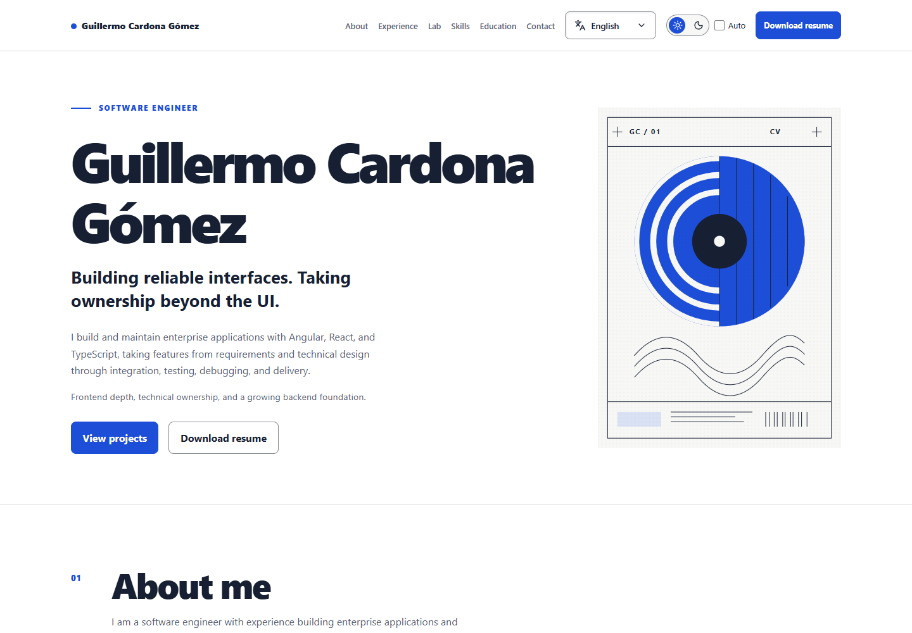
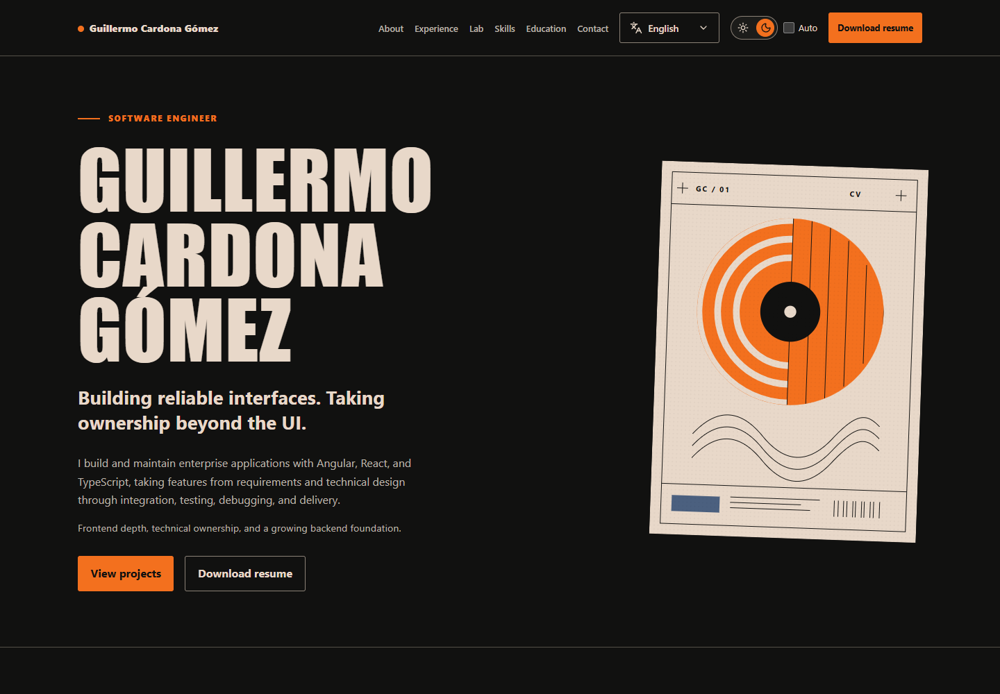
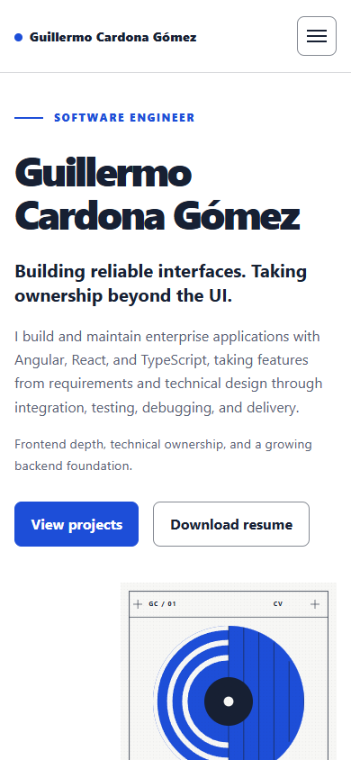
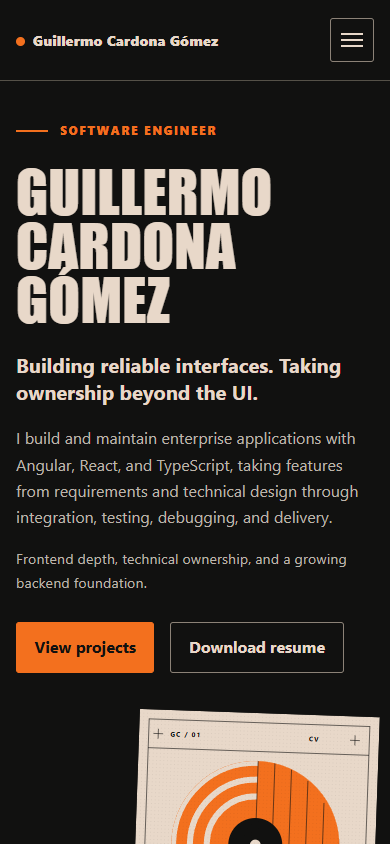
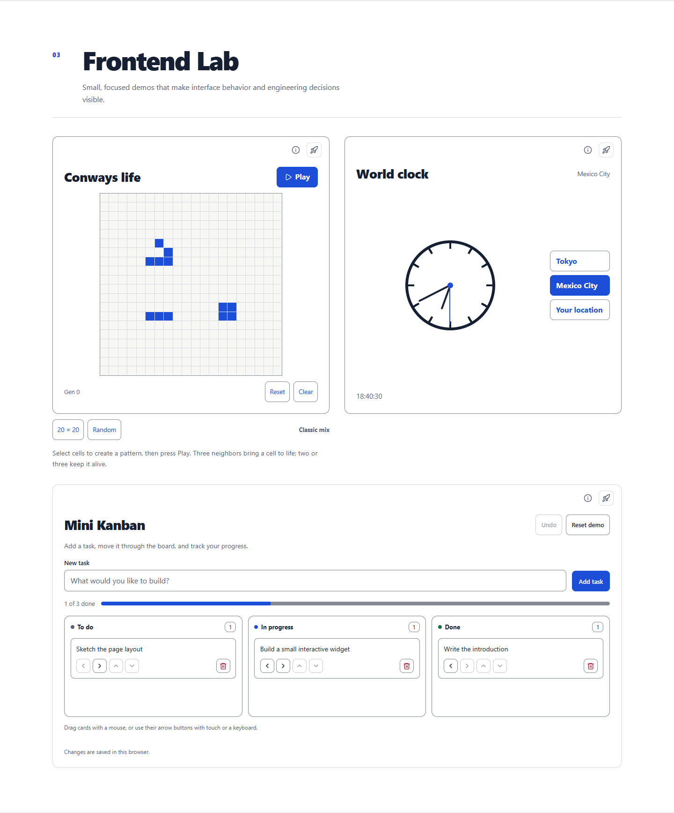
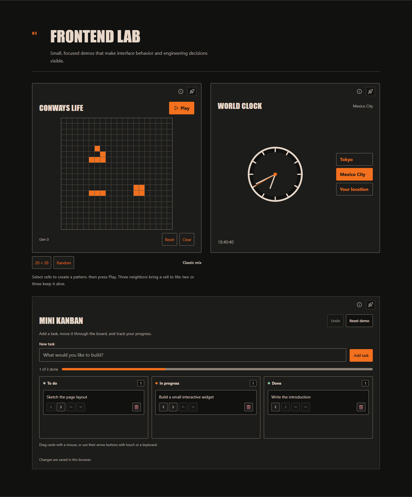

# Guillermo Cardona Gómez — Portfolio

A personal CV and portfolio built with Astro and TypeScript. It presents professional experience, skills, education, contact links, a downloadable resume, and an interactive Frontend Lab in English and Spanish.

## Screenshots

The light theme pairs white surfaces with blue controls. The dark theme uses an editorial Japanese retro style: ink black, cream, orange, condensed headings, flat panels, and an original geometric SVG poster.

All screenshots below show the English version of the production build. Click an image to open it at its original size.

### Desktop · 1440 × 1000

| Light theme | Dark theme |
| --- | --- |
| [](public/images/readme-desktop-light.png) | [](public/images/readme-desktop-dark.png) |

### Mobile · 390 × 844

| Light theme | Dark theme |
| --- | --- |
| [](public/images/readme-mobile-light.png) | [](public/images/readme-mobile-dark.png) |

### Frontend Lab

| Light theme | Dark theme |
| --- | --- |
| [](public/images/readme-lab-light.png) | [](public/images/readme-lab-dark.png) |

## Features

- **Two visual themes:** light and dark, plus an Auto option that follows the operating system. The first visit defaults to light; valid saved preferences are restored before the first paint. Using the switch while Auto is active selects a manual theme.
- **English and Spanish routes:** `/` and `/es/`, with a keyboard-accessible language picker that preserves the current section anchor.
- **Responsive layout:** desktop navigation, a collapsible menu on smaller screens, and layouts that adapt the content and Lab to the available width.
- **Conway's Game of Life:** editable cells, keyboard navigation, Play/Pause, Reset, Clear, preset selection through Random, and 20 × 20 or 30 × 30 boards.
- **World clock:** an analog dial and digital time for Tokyo, Mexico City, or the browser's local time zone.
- **Mini Kanban:** task creation, column movement, reordering, drag and drop, keyboard/touch buttons, deletion, Undo, reset, and browser storage. It supports up to 30 tasks with titles of up to 80 characters.
- **Contact and resume:** email links, clipboard copying with fallback feedback, profile links, and a downloadable PDF.
- **Accessibility support:** skip link, visible keyboard focus, reduced-motion styles, print styles, and a readable light-theme fallback when JavaScript is disabled.

Theme changes preserve the current widget state, including the Conway board, selected city, Kanban tasks, and unfinished input.

## Stack

| Area | Implementation |
| --- | --- |
| Site generation | Astro 7; static output |
| Language | TypeScript; strict Astro configuration |
| Interactivity | Browser scripts and native custom elements |
| Styling | CSS, semantic design tokens, media queries, and container queries |
| Icons | Lucide Astro |
| Unit tests | Node.js built-in test runner |

The build produces static files in `dist/`; no application server or database is required to serve the portfolio.

## Run locally

Use **Node.js 22.23.4 or newer** and npm.

```sh
npm ci
npm run dev -- --background
```

Astro reports the local URL when it starts, usually `http://localhost:4321`. Manage the background server with:

```sh
npm run dev -- status
npm run dev -- logs
npm run dev -- stop
```

## Commands

| Command | Description |
| --- | --- |
| `npm run dev -- --background` | Start the development server in the background. |
| `npm run dev -- status` | Show the development server's status and URL. |
| `npm run dev -- logs` | Read the background development server's logs. |
| `npm run dev -- stop` | Stop the background development server. |
| `npm test` | Run the unit tests. |
| `npm run build` | Generate the static site in `dist/`. |
| `npm run preview` | Preview an existing production build locally. |
| `npm run astro -- <command>` | Run an Astro CLI command. |

## Project structure

```text
src/
├── components/
│   ├── ConwaysLife/       # Simulation, patterns, styles, and helper tests
│   ├── LanguageSelect/    # Language picker and route navigation
│   ├── lab/mini-kanban/   # Task board, template, styles, and persistence
│   ├── layout/           # Header, footer, theme logic, and related tests
│   ├── sections/         # Hero, About, Experience, Lab, Skills, Education, Contact
│   └── ui/               # Shared elements, hero artwork, and world clock
├── data/                 # Translation dictionaries and structured portfolio data
├── i18n/                 # Locale selection, translation lookup, and interpolation
├── layouts/              # Shared document layout and theme bootstrap
├── pages/                # English (/) and Spanish (/es/) pages
├── styles/               # Theme tokens and global responsive styles
└── types/                # Portfolio content types
public/
├── images/               # Screenshots and visual assets
└── resume/               # Downloadable PDF
resume/                   # Editable resume source
docs/design/              # Design brief, references, and local validation evidence
```

## Update the content

| File or directory | Purpose |
| --- | --- |
| `src/data/portfolio.data.json` | Profile links, work history, technologies, education, and project metadata. |
| `src/data/en.json` and `src/data/es.json` | Translation dictionaries for the portfolio and localized controls. Some widget text is defined directly in its component or controller. |
| `src/i18n/index.ts` | Translation lookup, English fallback, and `{{placeholder}}` interpolation. |
| `src/components/sections/` | Section markup and composition. `Projects.astro` contains the Frontend Lab and portfolio project cards. |
| `src/styles/tokens.css` | Theme colors, typography, surfaces, borders, spacing, and motion tokens. |
| `src/styles/global.css` | Shared layout, section styles, responsive rules, and print styles. |
| `public/resume/guillermo-cardona-resume.pdf` | Public PDF served at `/resume/guillermo-cardona-resume.pdf`. Its URL is defined by `resumePath` in `src/data/content.ts`. |

Project cards are excluded when `published` is explicitly `false`. All current portfolio project entries are unpublished; the three Lab widgets remain visible independently.

The theme preference uses `localStorage.theme` with `light`, `dark`, or `system`. Mini Kanban stores its board separately under `portfolio:lab:mini-kanban:v1`; Undo history lasts for the current page session.

## Verification

```sh
npm test
npm run build
git diff --check
```

The unit suite covers Conway helpers and patterns, language navigation with section anchors, resume download wiring, and theme resolution/bootstrap, including blocked storage. There is no separate type-check command configured; a successful build is not a complete TypeScript check.

Optional browser validation scripts and saved results are available in `docs/design/validation/`. They use an existing Playwright installation and Chrome; Playwright is not a project dependency.

To regenerate the six README screenshots after building, set `PLAYWRIGHT_PATH` to an installed Playwright package if needed, then run:

```sh
node docs/design/validation/run.cjs readme-captures.cjs
```

This serves the production build temporarily on a local port, captures both themes in isolated browser contexts, writes the images to `public/images/`, and closes the temporary server.
