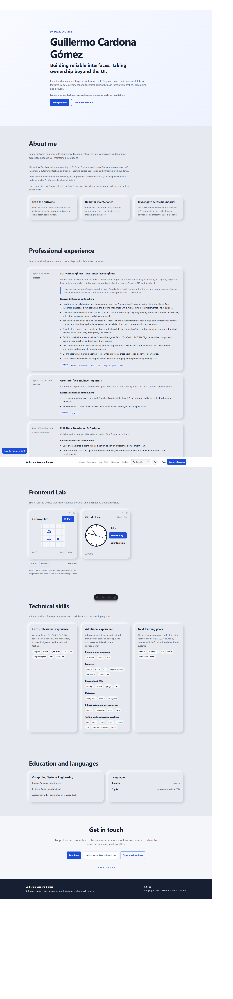
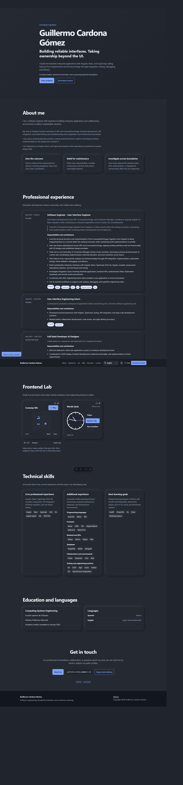
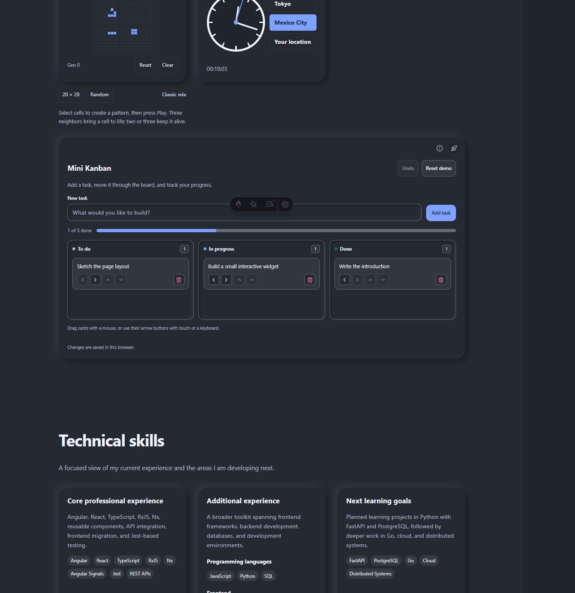
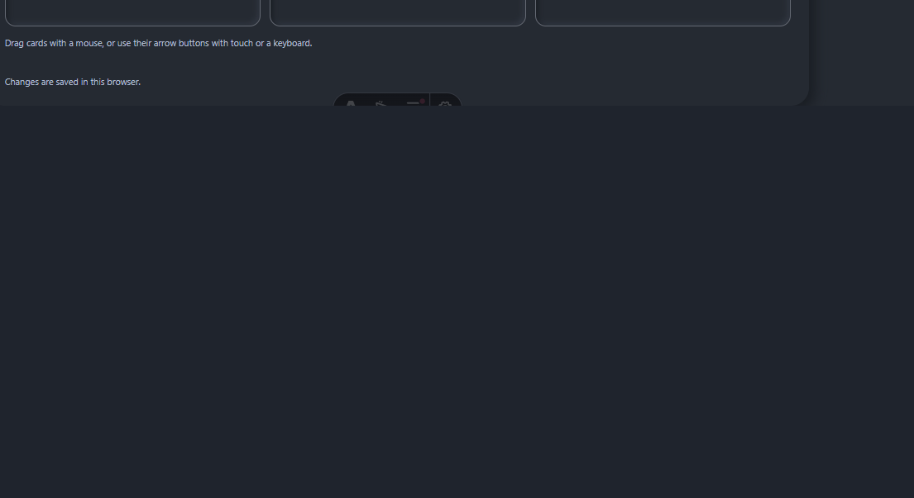
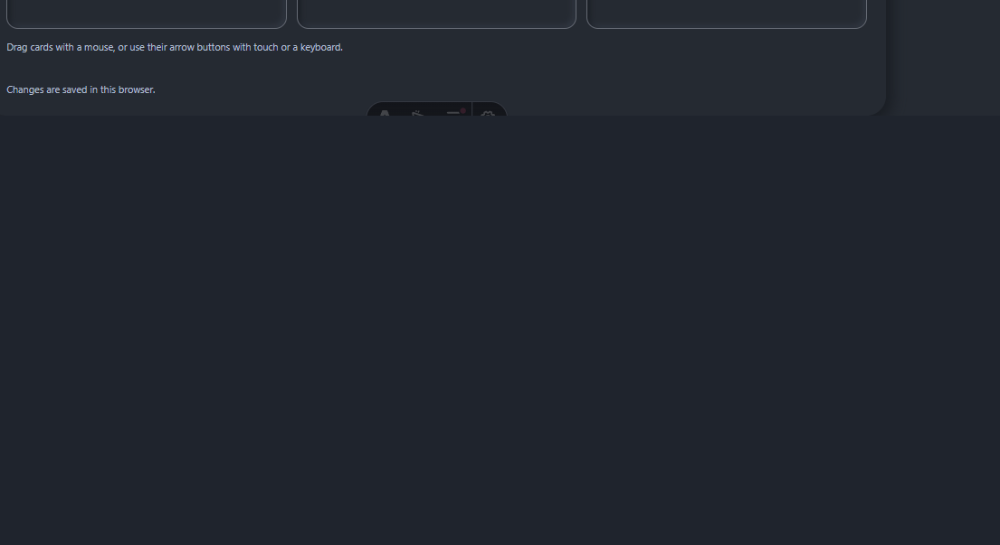
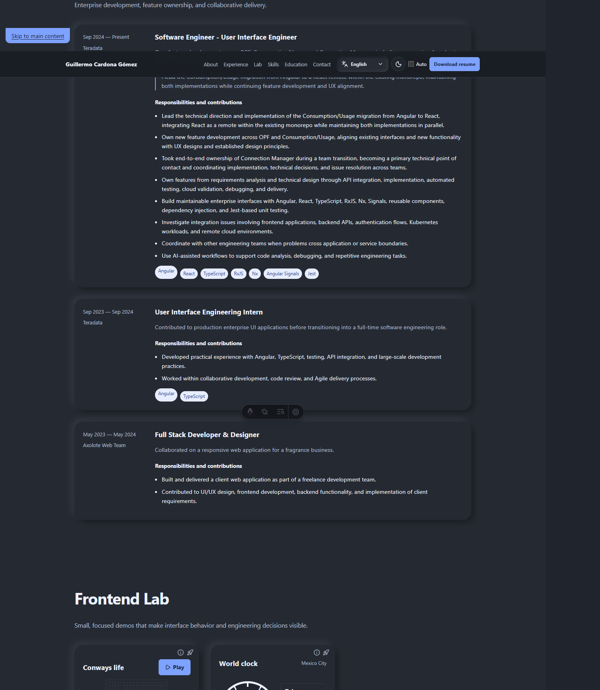

# Guillermo Cardona Gómez — Portfolio

Static personal CV and portfolio site built with Astro. It showcases professional experience, skills, education, contact options, and a downloadable resume.

## Visual preview

### Home (light and dark theme)




### Header controls (language, theme, resume download)


### Frontend Lab components

The Lab section includes Conway's Life plus a world clock card (CDMX / Tokyo / local time).



### Latest Lab updates

- Mini Kanban controls updated with Lucide-style directional icons and red trash action.
- Info/Rocket actions positioned in the top-right corner with instant tooltip behavior.
- Info/Rocket actions also available on Conway and World Clock cards with repository links.




### Neumorphism style update

Soft neumorphism cards were extended across core sections (About, Experience, Skills, Education, and Lab).



## Stack

- Astro 7
- TypeScript
- CSS (design tokens + responsive layout)
- Lucide Astro icons

The site is statically generated and compatible with Vercel deployment.

## Run locally

Use Node.js `22.23.4` or newer.

```sh
npm install
npm run dev
```

The development server is available at `http://localhost:4321`.

To run Astro in background mode:

```sh
npx astro dev --background
```

## Commands

| Command | Description |
| --- | --- |
| `npm run dev` | Start the local development server. |
| `npm run build` | Create the static production build in `dist/`. |
| `npm run preview` | Preview the production build locally. |
| `npm run test` | Run unit tests (Conway helpers, language navigation, resume download wiring). |
| `npm run astro -- <command>` | Run an Astro CLI command. |

## Project structure

```text
src/
├── components/
│   ├── ConwaysLife/    # Conway's Life card and controller
│   ├── LanguageSelect/ # Custom language picker (EN/ES)
│   ├── layout/         # Header and footer
│   ├── sections/       # Home page sections
│   └── ui/             # Shared UI elements (including WorldClockCard)
├── data/               # Canonical localized copy and portfolio data
├── i18n/               # Translation lookup and interpolation
├── layouts/            # Shared page layout
├── pages/              # Routes (/ and /es/)
├── styles/             # Global styles and design tokens
└── types/              # Content TypeScript types
public/
├── images/             # README and UI visual assets
└── resume/             # Public downloadable resume
resume/                 # Non-public editable resume source
```

## Content and i18n

- `src/data/en.json` and `src/data/es.json` contain all visible strings.
- `src/data/portfolio.data.json` contains structured profile, experience, projects, skills, and education data.
- Routes:
  - `/` → English
  - `/es/` → Spanish
- Only projects with `published: true` are rendered.
- Resume download path: `public/resume/guillermo-cardona-resume.pdf`.

## Verification

Run these checks before publishing changes:

```sh
npm run test
npm run build
```
